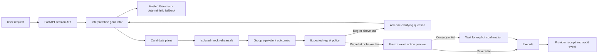
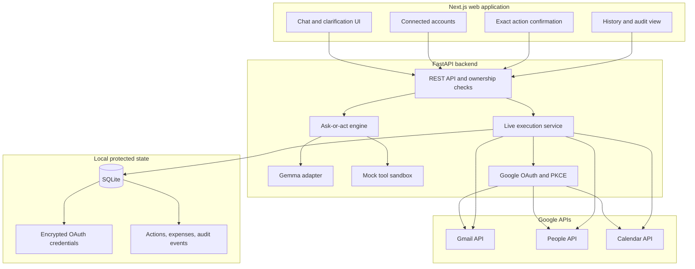
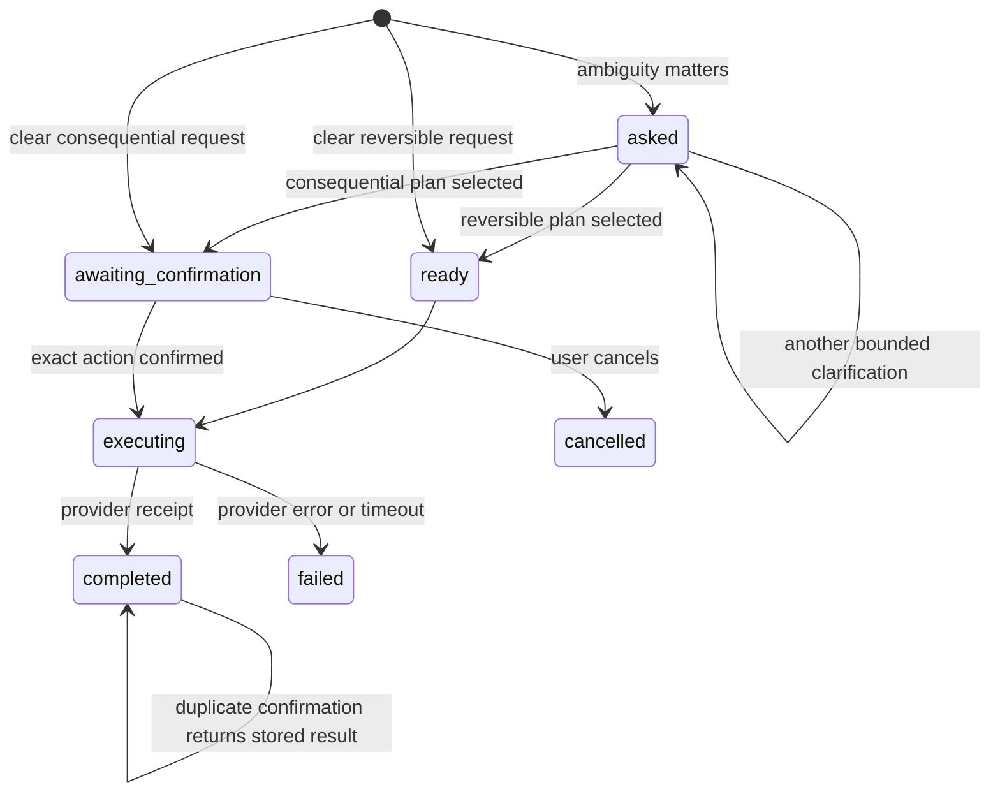
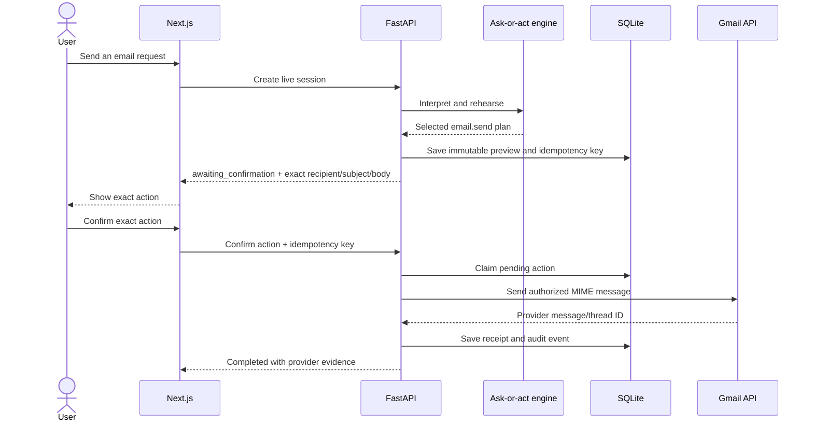

# Sawal

> An ask-or-act AI agent that interrupts only when ambiguity matters.

Sawal turns a natural-language request into several plausible interpretations, rehearses each one in an isolated world, estimates the cost of choosing incorrectly, and either asks one focused question or prepares an action. It supports a deterministic mock environment and a provider-backed live mode for Google services.

The central rule is simple: **reason broadly, preview precisely, and never claim a real-world action succeeded without provider evidence.**

## Highlights

- Ask-or-act policy driven by expected regret instead of a fixed confidence threshold.
- Hosted Gemma interpretation generation with deterministic offline fallback.
- Isolated rehearsal of candidate plans before any external side effect.
- Gmail search, read, draft, and send through user-authorized Google OAuth.
- Google Contacts grounding and Calendar availability/event operations.
- Exact confirmation previews for consequential actions.
- Idempotency protection against accidental duplicate sends or mutations.
- Encrypted OAuth credentials, persistent expenses, and an audit trail.
- Explicit capability reporting: unsupported live integrations never return fake success.
- Next.js interface for conversations, account connections, confirmations, history, world state, and benchmarks.

## How Sawal works



Sawal samples `K` interpretations and groups plans that produce the same canonical effect. If `p(g)` is the probability mass of outcome group `g` and `d(g*, g)` is the weighted difference from the most likely group, the decision score is:

```text
Expected regret R = sum over g of p(g) * d(g*, g)

R > tau   -> ASK
R <= tau  -> ACT
```

High-impact differences such as sending an email carry more weight than reversible differences such as creating a draft.

## System architecture

> Complete architecture diagrams, ask-or-act decision flows, and security trust boundaries are documented in [`docs/architecture/README.md`](docs/architecture/README.md).



### Backend responsibilities

| Module | Responsibility |
|---|---|
| `core/llm.py` | Structured interpretations, hosted Gemma calls, retries, timeouts, and fallback behavior. |
| `core/engine.py` | Rehearsal, effect grouping, expected-regret calculation, ASK/ACT decisions, and clarification. |
| `core/tools.py` | Allowlisted mock tools, validation, effect diffs, and reversibility weights. |
| `core/live.py` | Immutable previews, confirmation policy, action state machine, idempotency, and provider dispatch. |
| `core/oauth.py` | Google authorization-code flow, PKCE, expiring one-use state, and token exchange. |
| `core/providers/google.py` | Gmail, People, and Calendar REST operations with structured provider errors. |
| `core/storage.py` | SQLite actions, expenses, audit events, and Fernet-encrypted credentials. |
| `api/main.py` | HTTP contracts, session ownership, connection management, and live-action endpoints. |

## Action lifecycle



Consequential actions include Gmail send and Calendar create/update/cancel. The stored preview is the source of truth during confirmation; a changed request creates a new action instead of silently changing the pending one.

## Capability matrix

| Capability | Mock mode | Live mode | Confirmation |
|---|:---:|:---:|---|
| Contact search | Yes | Google People API | No |
| Email search/read | Yes | Gmail API | No |
| Email draft | Yes | Gmail API | No, because the draft is reversible |
| Email send | Yes | Gmail API | **Required** |
| Calendar list/free-busy | Yes | Google Calendar API | No |
| Calendar create/update/cancel | Yes | Google Calendar API | **Required** |
| Expense log/list | Yes | Persistent local SQLite ledger | Based on selected plan |
| Restaurant search/booking | Yes | Not configured | Booking cannot report live success |

A Gmail message ID proves that Gmail accepted the API request. It does not prove delivery, inbox placement, or that the recipient read it.

## Gmail send sequence



## Technology stack

| Layer | Technology |
|---|---|
| Web | Next.js 16, React 19, TypeScript, Tailwind CSS 4 |
| API | FastAPI, Pydantic, Uvicorn |
| Agent | Hosted Gemma through the Gemini API plus deterministic mock/replay paths |
| Integrations | Gmail API, Google People API, Google Calendar API |
| Persistence | SQLite |
| Credential protection | Fernet authenticated encryption |
| Testing | Pytest, FastAPI TestClient, ESLint, TypeScript, Next.js production build |

## Quick start

### Prerequisites

- Python 3.11 or newer
- Node.js 20 or newer
- npm
- A Gemini API key for hosted model calls; mock mode works without one
- Google OAuth credentials only if you want live Gmail, Contacts, or Calendar access

### 1. Clone and configure

```powershell
git clone https://github.com/kushagra240/Sawal.git
Set-Location Sawal
Copy-Item .env.example .env
```

Add your Gemini key to the local `.env` if you want hosted interpretations:

```env
GEMINI_API_KEY=your_key_here
GEMMA_MODEL_ID=gemma-4-26b-a4b-it
LLM_MODE=auto
```

Never commit `.env`. All browser-exposed variables must be intentionally prefixed with `NEXT_PUBLIC_`; provider secrets must never use that prefix.

### 2. Start the backend

```powershell
py -3 -m venv .venv
.\.venv\Scripts\python.exe -m pip install -r requirements.txt
.\.venv\Scripts\python.exe -m uvicorn api.main:app --host 127.0.0.1 --port 8000
```

### 3. Start the frontend

```powershell
npm --prefix web install
npm --prefix web run dev
```

Open:

- Application: http://localhost:3000
- Interactive API documentation: http://localhost:8000/docs
- Health check: http://localhost:8000/v1/health

### macOS/Linux equivalents

```bash
python3 -m venv .venv
source .venv/bin/activate
python -m pip install -r requirements.txt
python -m uvicorn api.main:app --host 127.0.0.1 --port 8000

# In another terminal
npm --prefix web install
npm --prefix web run dev
```

## Deploy to Render

The repository includes a two-service [Render Blueprint](render.yaml):

- `sawal-tarunkkumarsahu-api`: FastAPI backend with `/v1/health` health checks.
- `sawal-tarunkkumarsahu-web`: Next.js web service that proxies `/api` to the backend.

Open the [Render Blueprint installer](https://dashboard.render.com/blueprint/new?repo=https://github.com/kushagra240/Sawal), select the branch containing `render.yaml`, and provide the secret variables requested by Render. At minimum, set `GEMINI_API_KEY` for hosted Gemma. Google live tools additionally require `GOOGLE_CLIENT_ID` and `GOOGLE_CLIENT_SECRET`.

For Gmail OAuth on Render, register this production redirect URI in Google Cloud:

```text
https://sawal-tarunkkumarsahu-api.onrender.com/v1/oauth/google/callback
```

Free Render instances use an ephemeral filesystem. The default Render configuration therefore preserves SQLite state only until the service is restarted or redeployed. Use a persistent disk or a managed database before relying on OAuth connections, audit history, or expenses in production.

## Execution modes

Sawal has two independent mode choices:

### LLM mode

| Value | Behavior |
|---|---|
| `live` | Always call the configured model provider. |
| `record` | Call the provider and cache responses for later replay. |
| `replay` | Use recorded responses without network model calls. |
| `auto` | Attempt the provider and fall back to replay/deterministic behavior on failure. |

### Tool mode

| Value | Behavior |
|---|---|
| `mock` | Execute only against an isolated in-memory world. Default for development and tests. |
| `live` | Rehearse locally, then dispatch authorized operations to connected providers. |

The UI enables live Google tools only after a Google account is connected with the required scopes.

## Connect Google

Sawal does not accept or store your Google password. It uses Google OAuth 2.0 with an authorization-code flow and PKCE.

1. Enable Gmail API, Google Calendar API, and People API in a Google Cloud project.
2. Create a **Web application** OAuth client.
3. Register `http://localhost:8000/v1/oauth/google/callback` as an authorized redirect URI.
4. Add the account you will connect as an OAuth consent-screen test user when the app is in testing mode.
5. Add these server-side values to `.env`:

```env
GOOGLE_CLIENT_ID=your_client_id.apps.googleusercontent.com
GOOGLE_CLIENT_SECRET=your_client_secret
GOOGLE_REDIRECT_URI=http://localhost:8000/v1/oauth/google/callback
FRONTEND_URL=http://localhost:3000
SAWAL_TOKEN_ENCRYPTION_KEY=generate_and_keep_a_long_random_secret
```

6. Restart the backend, open the accounts panel, and select **Connect Google**.

See [Google OAuth setup](docs/GOOGLE_OAUTH_SETUP.md) for the complete walkthrough. Avoid bulk instructions such as "email all my contacts"; choose explicit recipients and review the exact preview.

## API overview

The stable local prefix is `/v1`. FastAPI also exposes the generated OpenAPI interface at `/docs`.

| Method | Endpoint | Purpose |
|---|---|---|
| `GET` | `/v1/health` | Runtime health and model mode. |
| `POST` | `/v1/sessions` | Create an ask-or-act session. |
| `POST` | `/v1/sessions/{id}/answer` | Answer a clarification question. |
| `POST` | `/v1/sessions/{id}/confirm` | Confirm an exact pending live action. |
| `POST` | `/v1/sessions/{id}/cancel` | Cancel a pending action. |
| `GET` | `/v1/actions` | List owned live actions and their states. |
| `GET` | `/v1/audit` | Read the current user's audit trail. |
| `GET` | `/v1/expenses` | Read persisted expenses. |
| `GET` | `/v1/providers/capabilities` | Inspect truthful provider availability. |
| `GET` | `/v1/connections` | Inspect connected accounts and granted scopes. |
| `GET` | `/v1/oauth/google/connect` | Start Google authorization. |
| `DELETE` | `/v1/connections/google` | Revoke and remove the Google connection. |

The maintained contract is in [contracts/openapi.yaml](contracts/openapi.yaml).

## Security and reliability guarantees

- OAuth access and refresh tokens remain on the backend and are encrypted at rest.
- OAuth state is random, expiring, one-use, and tied to a PKCE verifier.
- Every session and action is checked against the current local user boundary.
- Consequential actions require approval of an immutable stored preview.
- Idempotency keys make repeated confirmations return the stored result instead of repeating the provider call.
- Provider failures are recorded as failures; the UI never converts them into success language.
- Audit events contain action metadata and status, not OAuth tokens.
- `.env`, `.data/`, credentials, and runtime databases are ignored by Git.
- Automated tests use fake providers and never send real email or mutate a real calendar.

The current application uses a local guest identity boundary. Before a public multi-user deployment, replace it with verified application authentication while retaining the existing ownership checks.

## Tests and verification

```powershell
$env:LLM_MODE="mock"
.\.venv\Scripts\python.exe -m pytest -q
npm --prefix web run lint
npm --prefix web run build
```

The live-agent suite covers confirmation, cancellation, ownership isolation, provider failures, token refresh, encrypted credentials, OAuth state validation, Gmail response handling, and duplicate-execution prevention.

## Repository structure

```text
Sawal/
|-- api/                    FastAPI routes and HTTP boundary
|-- benchmark/              Evaluation tasks, runners, and results
|-- contracts/              OpenAPI contract
|-- core/
|   |-- providers/          External provider adapters
|   |-- engine.py           ASK/ACT policy and rehearsal engine
|   |-- live.py             Live action orchestration
|   |-- llm.py              Gemma and deterministic generation
|   |-- oauth.py            Google OAuth flow
|   |-- storage.py          Encrypted SQLite persistence
|   `-- tools.py            Mock tools and validation
|-- docs/                   Architecture audit and OAuth guide
|-- tests/                  Unit and API tests
|-- web/                    Next.js application
|-- .env.example            Safe configuration template
`-- requirements.txt        Python dependencies
```

## Current limitations

- Restaurant live booking has no authorized provider and is deliberately unavailable.
- Real Google integration requires developer-supplied OAuth credentials and user consent.
- SQLite is suitable for local/single-instance operation; distributed deployment needs a shared transactional store.
- Guest identity is not production-grade authentication.
- Provider acceptance is not the same as real-world delivery, attendance, or reading.

For deeper implementation and verification notes, read the [architecture audit](docs/ARCHITECTURE_AUDIT.md).

## Contributing

Contributions are welcome. Read [CONTRIBUTING.md](CONTRIBUTING.md) and keep external actions behind preview, authorization, confirmation, idempotency, and truthful provider receipts.

## License

Licensed under the [Apache License 2.0](LICENSE).
