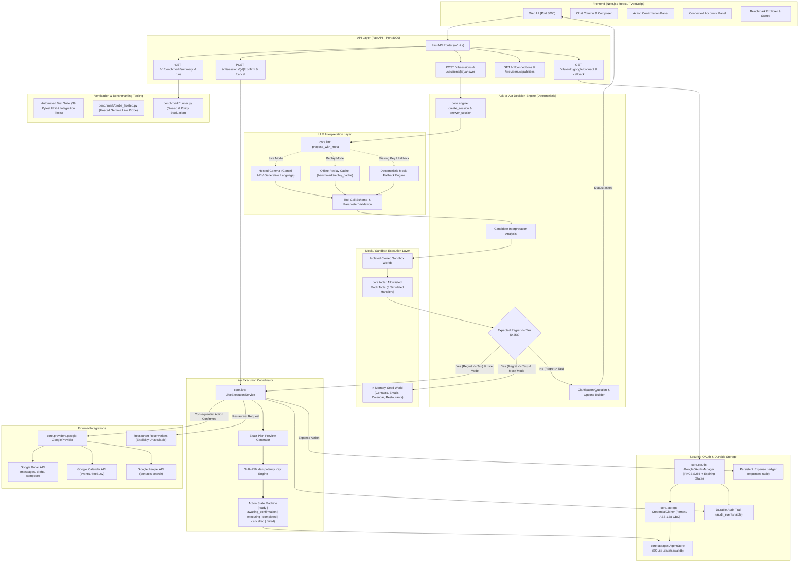
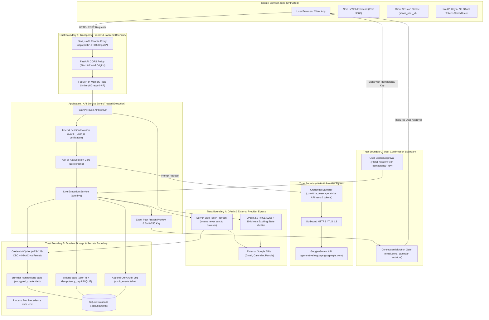

# SAWAL Architecture Documentation

This directory contains the architecture specification and diagrams for SAWAL, reflecting the integrated ask-or-act safety layer and live agent execution system.

## Table of Contents
1. [Diagram A — System Architecture](#diagram-a--system-architecture)
2. [Diagram B — Ask-or-Act Decision Flow](#diagram-b--ask-or-act-decision-flow)
3. [Diagram C — Deployment and Trust Boundaries](#diagram-c--deployment-and-trust-boundaries)
4. [Source Files](#source-files)

---

## Diagram A — System Architecture

The system consists of a Next.js / TypeScript web application, a FastAPI REST layer, a deterministic ask-or-act decision core, an LLM interpretation layer (hosted Gemma with replay and fallback), isolated sandbox execution, and a live execution coordinator integrating Google OAuth, Gmail, Calendar, and local persistence.

---

## Diagram B — Ask-or-Act Decision Flow

Every user instruction passes through interpretation, rehearsal, regret calculation, and exact-plan validation. If uncertainty or reversibility risk is high (`expected_regret > tau`), SAWAL asks a targeted clarifying question instead of acting prematurely. If the action is consequential in live mode, an immutable preview and idempotency key are generated, requiring explicit confirmation before provider execution.

```mermaid
flowchart TD
  Start(["User Instruction (request_text)"]) --> ModeCheck{"tool_mode setting"}

  ModeCheck -->|"live"| GroundContacts["Enrich Contacts via Google Contacts API (if connected)"]
  ModeCheck -->|"mock"| DirectSeed["Use In-Memory Seed World"]

  GroundContacts --> ProposeInterpretations["Generate Candidate Interpretations (core.llm)"]
  DirectSeed --> ProposeInterpretations

  ProposeInterpretations --> LLMProviderBranch{"LLM Provider / Mode Selection"}
  LLMProviderBranch -->|"Live API & GEMINI_API_KEY set"| HostedCall["Call Google Gemini REST API"]
  LLMProviderBranch -->|"Replay Mode / Cache exists"| ReplayHit["Load from Replay Cache"]
  LLMProviderBranch -->|"Missing Key or Request Failure"| FallbackMock["Deterministic Mock Fallback"]

  HostedCall --> ValidateSchema{"Validate Tool Calls & Args (core.tools.validate_call)"}
  ReplayHit --> ValidateSchema
  FallbackMock --> ValidateSchema

  ValidateSchema -->|"Valid Tools"| SandboxRehearsal["Rehearse Each Plan in Cloned World Sandbox"]
  ValidateSchema -->|"Invalid Tool"| RejectTool["Strip Invalid Tool / Fallback"]
  RejectTool --> SandboxRehearsal

  SandboxRehearsal --> GroupEffects["Cluster Interpretations by Canonical Effect Signature"]
  GroupEffects --> RegretCalc["Compute Expected Regret vs Tau (default: 0.25)"]

  RegretCalc --> RegretDecision{"Expected Regret > Tau?"}

  RegretDecision -->|"YES: Ambiguity / High Regret"| BuildQuestion["Construct Disambiguation Question & Options (Status: asked)"]
  BuildQuestion --> PresentUser["Return Question to User in UI"]
  PresentUser --> UserAnswers["User Submits Answer (/v1/sessions/{id}/answer)"]
  UserAnswers --> FilterInterpretations["Filter Candidate Interpretations to Matching Outcome"]
  FilterInterpretations --> SandboxRehearsal

  RegretDecision -->|"NO: Low Regret / Resolved"| ExecutionModeBranch{"tool_mode == 'live'?"}

  ExecutionModeBranch -->|"mock"| ExecuteSandbox["Apply Effects to In-Memory World (Status: completed)"]
  ExecuteSandbox --> ReturnMockReceipt["Return Session Result & World Diff"]

  ExecutionModeBranch -->|"live"| FreezePlan["Freeze Exact Plan & Generate Preview (core.live)"]
  FreezePlan --> ComputeIdempotency["Generate SHA-256 Idempotency Key"]
  ComputeIdempotency --> CheckConsequential{"Plan Contains Consequential Tools? (email.send, calendar.create/update/cancel, restaurants.book)"}

  CheckConsequential -->|"YES: High Risk"| AwaitConfirm["State: awaiting_confirmation"]
  AwaitConfirm --> UserConfirmDecision{"User Action via UI"}
  UserConfirmDecision -->|"POST /sessions/{id}/cancel"| MarkCancelled["State: cancelled (Audit: ACTION_CANCELLED)"]
  UserConfirmDecision -->|"POST /sessions/{id}/confirm"| VerifyConfirmation["Verify Ownership & Idempotency Key"]

  CheckConsequential -->|"NO: Low Risk (draft, list, expense)"| StateReady["State: ready"]
  StateReady --> VerifyConfirmation

  VerifyConfirmation --> CheckActionState{"Action Current State"}
  CheckActionState -->|"Already completed"| ReturnCachedReceipt["Return Cached Execution Result (Idempotent)"]
  CheckActionState -->|"Cancelled or Failed"| RejectExecution["HTTP 409 Conflict (Action already terminal)"]
  CheckActionState -->|"awaiting_confirmation or ready"| BeginExecution["State: executing (Audit: ACTION_EXECUTION_STARTED)"]

  BeginExecution --> ExecuteToolDispatch["Dispatch Tools to Providers"]

  ExecuteToolDispatch --> ToolTypeBranch{"Tool Domain"}
  ToolTypeBranch -->|"Google (Gmail, Calendar, People)"| GoogleCheckToken["Validate Token -> Refresh if Expired -> Call Google REST API"]
  ToolTypeBranch -->|"Expenses (expenses.log/list)"| SQLiteExpense["Record / Query SQLite Expense Ledger"]
  ToolTypeBranch -->|"Restaurants (restaurants.*)"| RestReject["Raise ProviderUnavailable (Truthful: No Booking Made)"]

  GoogleCheckToken --> ProviderOutcome{"Provider Response"}
  SQLiteExpense --> ProviderOutcome
  RestReject --> ProviderOutcome

  ProviderOutcome -->|"Success"| MarkCompleted["State: completed + Provider Receipt (Audit: ACTION_COMPLETED)"]
  ProviderOutcome -->|"Provider Error / Timeout"| MarkFailed["State: failed + Error Details (Audit: ACTION_FAILED)"]

  MarkCompleted --> FinalResponse(["Update Session Status & Return Response to Client"])
  MarkFailed --> FinalResponse
  MarkCancelled --> FinalResponse
  ReturnCachedReceipt --> FinalResponse
  ReturnMockReceipt --> FinalResponse
```

---

## Diagram C — Deployment and Trust Boundaries

The system enforces five strict security and trust boundaries, preventing secret leakage, unauthorized actions, and credential abuse.

---

## Source Files

- System Architecture Source: [`system_architecture.mmd`](./system_architecture.mmd)
- Ask-or-Act Decision Flow Source: [`decision_flow.mmd`](./decision_flow.mmd)
- Trust Boundaries Source: [`trust_boundaries.mmd`](./trust_boundaries.mmd)
- Comprehensive Architecture Audit: [`../ARCHITECTURE_AUDIT.md`](../ARCHITECTURE_AUDIT.md)
